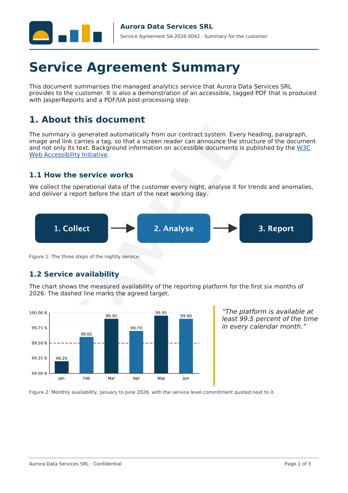
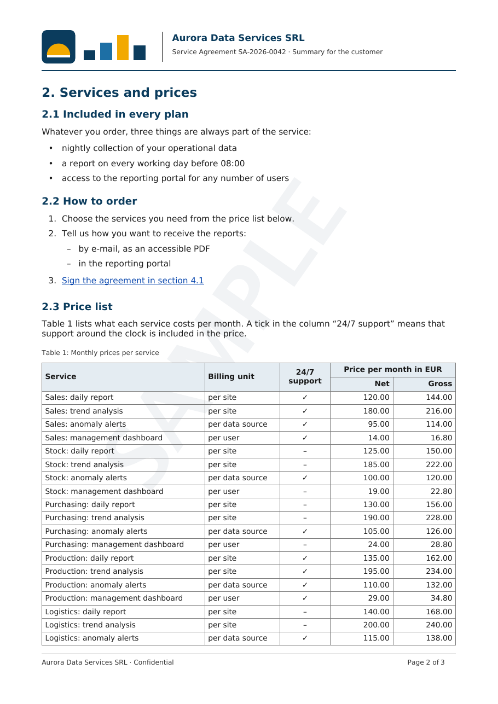
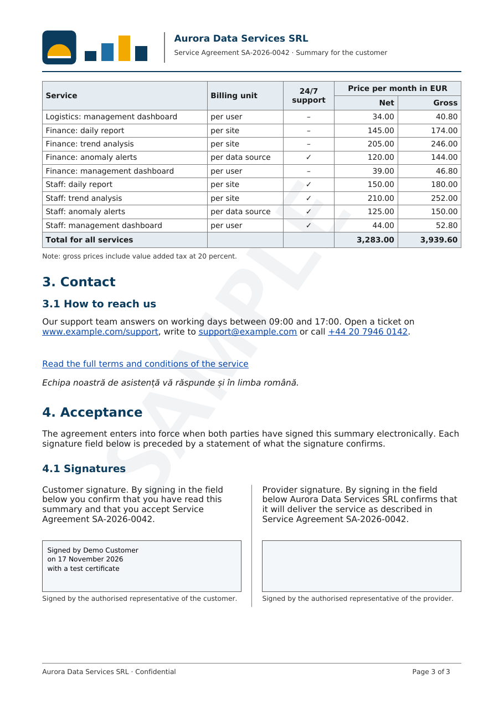
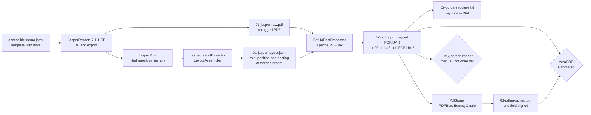

# PDF/UA from JasperReports Community Edition

A proof of concept. JasperReports generates an ordinary, **untagged** PDF, and a post-processing
step built on Apache PDFBox turns it into an accessible **PDF/UA** document: **PDF/UA-1**
(ISO 14289-1) by default, **PDF/UA-2** (ISO 14289-2:2024, on PDF 2.0) on request. Either way the
document gets a complete tag tree, headings, tables, lists, figures, artifacts, tagged links
(web, e-mail, phone, internal) and signature fields that a screen reader can announce. A last
step signs a field digitally without breaking any of it.

> [!IMPORTANT]
> **Status.** The generated documents, unsigned and signed, pass the veraPDF validation for
> their part (the PDF/UA-1 profile, or the PDF/UA-2 profile for the PDF/UA-2 variant), and 79
> automated tests check the tagging directly. The sessions that built the project could not run
> **PAC** (Windows only) or a **screen reader**, and no result of either is recorded in this
> repository yet; whether PAC checks PDF/UA-2 at all is not known. Until that is done, read
> "passes validation" as "passes the machine-checkable rules", not as "is accessible". Details:
> [docs/verification.md](docs/verification.md).
>
> The whole project (code, template, tests, documentation) was written by an AI model. The
> prompts, the model and the process are in
> [docs/development-process.md](docs/development-process.md).

| Page 1 | Page 2 | Page 3 |
|---|---|---|
|  |  |  |

The generated files are committed in [docs/sample-output](docs/sample-output), so you can open
[`02-pdfua.pdf`](docs/sample-output/02-pdfua.pdf) (PDF/UA-1),
[`02-pdfua2.pdf`](docs/sample-output/02-pdfua2.pdf) (PDF/UA-2) or their signed versions in a
checker without building anything.

## Why this exists

Since version 7.0.8 the Community Edition of JasperReports no longer contains a working PDF
tagger. The tagging code was isolated behind a `PdfTagger` interface and its implementation
moved to the commercial Professional extensions; the tagger left in the open source library
throws *"Tagged PDF export is not supported"* as soon as a report asks for a tagged export
([release notes](https://github.com/Jaspersoft/jasperreports/releases)).

This project keeps JasperReports Community Edition and gets to PDF/UA another way:

- JasperReports runs with its no-op `SilentPdfTaggerFactory`, so it never fails and always
  writes a plain PDF;
- the template states what each element *means* with element properties. The tagging
  properties JasperReports defines itself are understood, so a template written for its tagger
  keeps working;
- a post-processor does all the tagging as the last step of the flow.

## How it works



1. **Generate.** JasperReports fills the template and exports a PDF. It contains only drawing
   instructions: no tags, no signature fields.
2. **Remember the meaning.** The filled report (`JasperPrint`) still knows which element is a
   heading, which is a table cell, which image has which alternate text, and where each element
   ended up on the page. Cells are put into rows and tables, list items into lists, and the
   result is written to a JSON file, the *layout*.
3. **Match.** The post-processor walks through the content stream of every page, works out
   where each text run, image and path is painted, and finds the layout element at that position.
4. **Mark.** Content of an element with a role is wrapped in tagged marked content and attached
   to a structure element. Everything else (lines, borders, page header and footer, the repeated
   logo, the watermark, table headers repeated on the next page) is wrapped as an artifact.
   Nothing is left unmarked.
5. **Complete.** Link annotations are put into `Link` elements, signature fields are created
   inside `Form` elements, and the document level requirements are set: PDF/UA identifier, title,
   language, tab order, bookmarks.
6. **Sign** (optional). A field is signed as an incremental update. The file stays PDF/UA, and
   the field's description tells a screen reader that it has been signed and by whom.

Steps 4 and 5 are where the two parts of PDF/UA differ; the content, the reading order and the
artifacts are the same.

The full description, with the algorithms, the PDF objects that are written and the design
decisions, is in [docs/architecture.md](docs/architecture.md).

## Try it

Requirements: a JDK (17 or newer) and Maven. Tested with Java 17 and 21, Maven 3.8.4 and 3.9.16,
on macOS and Linux.

```sh
mvn test                                         # generate both variants and verify them (about two minutes; the first run downloads dependencies)
mvn compile exec:java                            # only generate PDF/UA-1, into target/pdf
mvn compile exec:java -Dexec.args="--pdfua=2"    # only generate PDF/UA-2, into target/pdf-ua2
                                                 # an output directory can be added: -Dexec.args="--pdfua=2 some/dir"
```

Files written to `target/pdf/` (PDF/UA-1):

| File | Content |
|---|---|
| `01-jasper-raw.pdf` | the PDF exactly as JasperReports exported it: untagged |
| `01-jasper-layout.json` | role, position and nesting of every report element |
| `02-pdfua.pdf` | the post-processed PDF/UA-1 document; **this is the one to check** |
| `02-pdfua-structure.txt` | its tag tree and artifacts as readable text |
| `03-pdfua-signed.pdf` | the same document with the customer's field signed, using a throw-away test certificate |
| `04-verapdf-pdfua1-report.txt` | veraPDF result for the three PDFs (written by `mvn test` only) |

For PDF/UA-2, `target/pdf-ua2/` holds the same set with `pdfua2` in the names:
`02-pdfua2.pdf`, `02-pdfua2-structure.txt`, `03-pdfua2-signed.pdf`,
`04-verapdf-pdfua2-report.txt`.

To look inside a PDF without PAC:

```sh
pdfinfo -struct-text target/pdf/02-pdfua.pdf                    # poppler: tag tree with text
pdfsig target/pdf/03-pdfua-signed.pdf                           # poppler: is the signature valid?
mvn exec:java@pdf-debugger                                      # PDFBox PDFDebugger on 02-pdfua.pdf
mvn exec:java@pdf-debugger -Dpdf=target/pdf/01-jasper-raw.pdf   # ... or on any other file
```

## PDF/UA-1 or PDF/UA-2

The same template and the same layout give either document; only the post-processor's output
differs. PDF/UA-1 is the default because it is what the PAC checker tests.

| | PDF/UA-1 (default) | PDF/UA-2 |
|---|---|---|
| Standard, PDF version | ISO 14289-1:2014, PDF 1.7 | ISO 14289-2:2024, PDF 2.0 (`%PDF-2.0`) |
| XMP identification | `pdfuaid:part` 1 | `pdfuaid:part` 2, `pdfuaid:rev` 2024 |
| Structure types | PDF 1.7; `Title` role mapped to `P` | every element in a namespace: PDF 2.0 where PDF 2.0 has the type (`Title` included); `FENote` instead of `Note`; `BlockQuote` stays a PDF 1.7 type; a fallback role map for readers that predate PDF 2.0 |
| Bookmarks, links inside the document | page destinations | page **and** structure destinations: they lead to the heading or element, not just to the page |
| Signature fields | description in `TU` | description in `TU` and in `Contents` |
| Verified with | veraPDF PDF/UA-1 profile; poppler reads the tag tree; PAC not yet run | veraPDF PDF/UA-2 profile (with the ISO 32005 nesting rules); poppler reads the tag tree; whether PAC supports PDF/UA-2 is unknown |

```java
PdfUaPostProcessor.process(rawPdf, layout, target);                       // PDF/UA-1
PdfUaPostProcessor.process(rawPdf, layout, target, PdfUaPart.PDF_UA_2);   // PDF/UA-2
```

Two template features are refused for PDF/UA-2, because PDF/UA-2 forbids or requires something
the layout cannot give: the unnumbered heading `H`, and `TOCI`. Details:
[docs/architecture.md](docs/architecture.md#7-pdfua-1-and-pdfua-2).

## What the template has to say

The meaning of an element comes from properties in the JRXML. The most important ones:

| Property | On | Purpose |
|---|---|---|
| `net.sf.jasperreports.export.pdf.metadata.title` | report | document title (PDF/UA requires one) |
| `net.sf.jasperreports.export.pdf.tag.language` | report, element | language of the document, or of one element in another language |
| `pdfua.role` | element | `Title`, `H1`..`H6`, `P`, `Figure`, `Caption`, `Note`, `TH`, `TD`, `Lbl`, `LBody`, `BlockQuote`, ... or `Artifact` |
| `pdfua.alt` | image | alternate text |
| `net.sf.jasperreports.components.table.accessible` | report | the table component marks its rows, cells and spans by itself |
| `pdfua.signature.name`, `pdfua.signature.description` | rectangle or frame | create a signature field here; the description says what is being signed |

Sensible defaults keep templates short: text is a paragraph, an image with alternate text is a
figure, everything in the page header, footer and background is an artifact, and so is every
line, rectangle and border. **Nesting is worked out from the roles:** cells at the same height
are a row and consecutive rows are a table, also across page breaks; a label and a body are a
list item and consecutive items are a list. A complete list item:

```xml
<element kind="staticText" x="8" y="76" width="14" height="16">
    <text><![CDATA[•]]></text>
    <property name="pdfua.role" value="Lbl"/>
</element>
<element kind="staticText" x="24" y="76" width="471" height="16">
    <text><![CDATA[nightly collection of your operational data]]></text>
    <property name="pdfua.role" value="LBody"/>
</element>
```

Because a property can be an expression, the header logo is content on the first page and
decoration afterwards (`$V{PAGE_NUMBER} == 1 ? "Figure" : "Artifact"`). Links are ordinary
JasperReports hyperlinks with the right URI scheme (`https:`, `mailto:`, `tel:`). Everything
else is in the [template guide](docs/template-guide.md).

## What comes out

Excerpts of `02-pdfua-structure.txt` (the complete file is in
[docs/sample-output](docs/sample-output/02-pdfua-structure.txt)). A list with a nested list:

```text
L  ListNumbering=Decimal
  LI
    Lbl  [page 2]
      - "1."
    LBody  [page 2]
      - "Choose the services you need from the price list below."
  LI
    Lbl  [page 2]
      - "2."
    LBody
      P  [page 2]
        - "Tell us how you want to receive the reports:"
      L  ListNumbering=Disc
        LI
          Lbl  [page 2]
            - "–"
          LBody  [page 2]
            - "by e-mail, as an accessible PDF"
```

The table, which starts on page 2 and ends on page 3, as one `Table`:

```text
Table  Summary="One row per service with its billing unit, whether 24/7 support is included, ..."
  Caption  [page 2]
    - "Table 1: Monthly prices per service"
  TR
    TH  Scope=Column  RowSpan=2
      P  [page 2]
        - "Service"
    ...
    TH  Scope=Column  ColSpan=2
      P  [page 2]
        - "Price per month in EUR"
  TR
    TH  Scope=Column
      P  [page 2]
        - "Net"
    ...
  TR
    TH  Scope=Row
      P  [page 2]
        - "Sales: daily report"
    TD
      P  [page 2]
        - "per site"
    TD
      P  [page 2]  ActualText="included"
        - "✓"
    ...
```

Links and a signature field:

```text
P  [page 3]
  - "Our support team answers on working days between 09:00 and 17:00. Open a ticket on "
  Link  [page 3]
    - "www.example.com/support"
    > Link annotation  URI=https://www.example.com/support  Contents="www.example.com/support"
  - ", write to "
  Link  [page 3]
    - "support@example.com"
    > Link annotation  URI=mailto:support@example.com  Contents="support@example.com"
  - " or call "
  Link  [page 3]
    - "+44 20 7946 0142"
    > Link annotation  URI=tel:+442079460142  Contents="+44 20 7946 0142"
  - "."
...
P  [page 3]
  - "Customer signature. By signing in the field below you confirm that you have read this summary and that you accept Service Agreement SA-2026-0042."
Form  [page 3]
  > Widget annotation  FieldType=Sig  Name=CustomerSignature  Description(TU)="Customer signature. By signing here you confirm that you have read this summary and that you accept Service Agreement SA-2026-0042."
```

and, at the end of the same file, what assistive technology does *not* get (the notes after
`<-` are added here, they are not in the file):

```text
ARTIFACTS (not presented by assistive technology)
  Page 3
    Pagination/Watermark: (image)         <- "SAMPLE" behind the page
    Pagination/Header: (image)            <- the logo, a Figure on page 1 only
    Pagination/Header: "Aurora Data Services SRL"
    Pagination: "Service"                 <- table header row, repeated from page 2
    Pagination: "Billing unit"
    ...
    Layout: (graphics)                    <- cell borders, lines
    Pagination/Footer: "Page 3 of"
```

## What is verified, and what is not

| What | How | Result |
|---|---|---|
| Machine-checkable PDF/UA-1 rules | veraPDF 1.30.4, PDF/UA-1 profile, part of `mvn test` | **pass** for `02-pdfua.pdf` and `03-pdfua-signed.pdf`; the raw JasperReports file fails 8 rules |
| Machine-checkable PDF/UA-2 rules, and the nesting rules of ISO 32005 | veraPDF 1.30.4, PDF/UA-2 profile, part of `mvn test` | **pass** for `02-pdfua2.pdf` and `03-pdfua2-signed.pdf` (about 31,700 checks); the raw file fails 7 rules |
| PDF/UA-1 and PDF/UA-2 output hold the same content in the same order | test that compares the two tag trees | **identical**, apart from `Note`/`FENote` |
| Everything is tagged or an artifact; logo, lines, header and footer; links; signature fields | JUnit tests that read the PDF back with plain PDFBox | **pass** |
| Table: one table over two pages, header scopes, spans, regular rows, repeated headers as artifacts; lists and nested list; note, language, replacement text | same | **pass** |
| A plain column-header-and-detail-band report over three pages, marked in two different ways | same | **pass** |
| Post-processing does not change the look of the pages | raw and final file rendered and compared pixel by pixel (PDFBox in a test; poppler by hand) | **identical** |
| The signature is valid and covers the whole file; signing only appends; a second signature can follow | BouncyCastle in a test; poppler `pdfsig` by hand, for both parts | **pass** |
| The tag tree is readable by another PDF library | poppler `pdfinfo -struct-text` | same tree, for both parts; for PDF/UA-2 only thanks to a fallback role map, without which poppler dropped the title and the note |
| Builds from a clean checkout | Ubuntu 24.04 container with an empty Maven repository; macOS | **pass** |
| PAC (PDF Accessibility Checker) | Windows only | **not run**; whether it checks PDF/UA-2 is not known |
| Screen reader (NVDA, JAWS, VoiceOver) | manual | **not run** |
| Opening the files, tabbing through and signing in Adobe Acrobat | manual | **not run** |
| A signature with a real certificate, time stamp or long-term validation | needs a trust service | **not done** |
| The GitHub Actions workflow in `.github/workflows` | needs a push | **not run** |
| Anything a machine cannot judge: sensible reading order, good alternate texts, colour contrast | human review | **not done** |

How to do the manual checks, and where to record the results:
[docs/verification.md](docs/verification.md). How each PDF/UA requirement is met and tested:
[docs/pdfua-compliance.md](docs/pdfua-compliance.md).

## Known limits

This is a proof of concept for one kind of document, not a library.

- **Matching is geometric.** Content is assigned to report elements by position, so overlapping
  elements can be confused. Rotated text and many JasperReports components (charts, barcodes,
  crosstabs, subreports) are untested.
- **Tables are simple tables.** Header scope, row and column spans and captions are written;
  `THead`/`TBody`, `Headers`/`ID` associations and tables inside tables are not. Rows are
  recognised by the height of their cells unless the template marks them.
- **Lists need one element per label and body.** A list written as HTML or styled text inside a
  single text element stays one paragraph.
- **One text element, one page.** A text that JasperReports splits across a page break becomes
  two paragraphs. (Tables and lists do continue across pages.)
- **Reading order is template order**, not visual order.
- **No interactive form fields** other than signatures, **no table of contents**.
- **Signing is a demonstration.** It uses a self-signed test certificate; there is no time
  stamp and no long-term validation data.
- **PDF/UA-2 is checked by veraPDF only.** Besides poppler, no other validator, reader or
  assistive technology has seen the PDF/UA-2 output, and support for PDF 2.0 in readers and
  screen readers is uneven: poppler dropped the PDF 2.0 types until a fallback was added.
  Footnotes cited from the text (`Ref` in both directions) are not supported.
- **No PDF/A, no encryption.**

The complete list, including the risks of the approach, is in
[docs/limitations.md](docs/limitations.md).

## Documentation

| Document | Read it when you want to |
|---|---|
| [docs/architecture.md](docs/architecture.md) | understand how the flow and the algorithms work, with diagrams and real PDF excerpts |
| [docs/template-guide.md](docs/template-guide.md) | write or adapt a JasperReports template for this flow |
| [docs/pdfua-compliance.md](docs/pdfua-compliance.md) | see which PDF/UA-1 requirement is handled where, and which test covers it |
| [docs/verification.md](docs/verification.md) | know what the tests prove, and check the result yourself (PAC, screen reader, macOS tools) |
| [docs/limitations.md](docs/limitations.md) | know what does not work, what is untested and what could break |
| [docs/development-process.md](docs/development-process.md) | see the prompts, the model, the decisions and the mistakes made on the way |
| [AGENTS.md](AGENTS.md) | work on this repository as (or with) an AI coding agent |

## Licence

[Apache License 2.0](LICENSE). The libraries the project uses have their own licences, listed
under "Third-party software" below.

## About the demo content

Aurora Data Services SRL, Service Agreement SA-2026-0042 and every figure and price in the demo
document are invented. Web and e-mail addresses use the reserved `example.com` domain, and the
phone number is from the range the UK regulator reserves for drama use. Any resemblance to a
real company is accidental.

The signature in `03-pdfua-signed.pdf` is made with a certificate that the build creates on the
spot for "Demo Customer" and then forgets. It proves nothing about anyone, and a PDF viewer
will rightly say that it cannot verify the signer.

## Third-party software

Nothing is redistributed in this repository; Maven downloads the libraries. Their licences,
as declared by the projects (check upstream for the authoritative terms):

| Library | Used for | Licence |
|---|---|---|
| [JasperReports Library](https://github.com/Jaspersoft/jasperreports) 7.1.1 (incl. `jasperreports-pdf`, `-jdt`, `-fonts`) | report generation | LGPL |
| [OpenPDF](https://github.com/LibrePDF/OpenPDF) 1.3.43 | PDF writer used by JasperReports | LGPL / MPL |
| DejaVu fonts (inside `jasperreports-fonts`) | embedded fonts of the demo and of the visible signature | Bitstream Vera / DejaVu font licence |
| [Apache PDFBox](https://pdfbox.apache.org/) 3.0.8 | post-processing, signing, debugger | Apache License 2.0 |
| [Bouncy Castle](https://www.bouncycastle.org/) 1.87 | signature container (CMS), test certificate | Bouncy Castle Licence (MIT style) |
| [veraPDF](https://verapdf.org/) 1.30.4 | validation, tests only | GPL v3+ / MPL 2.0 |
| [JUnit](https://junit.org/) 6.1.3 | tests only | EPL 2.0 |

`jasperreports-pdf` 7.1.1 declares a dependency on a Jaspersoft build of OpenPDF
(`1.3.43.jaspersoft.2`) that is not on Maven Central. The POM excludes it and uses the stock
OpenPDF 1.3.43, which the JasperReports release notes describe as supported; the patched build
is only needed by their own tagger.
