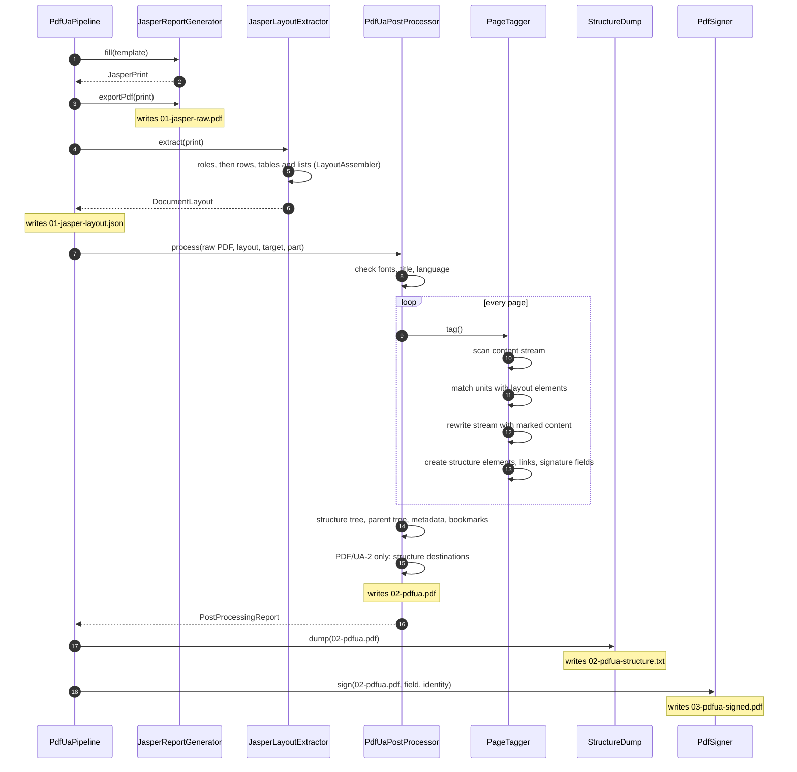
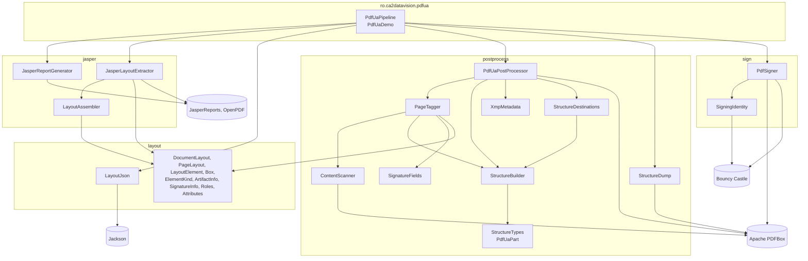
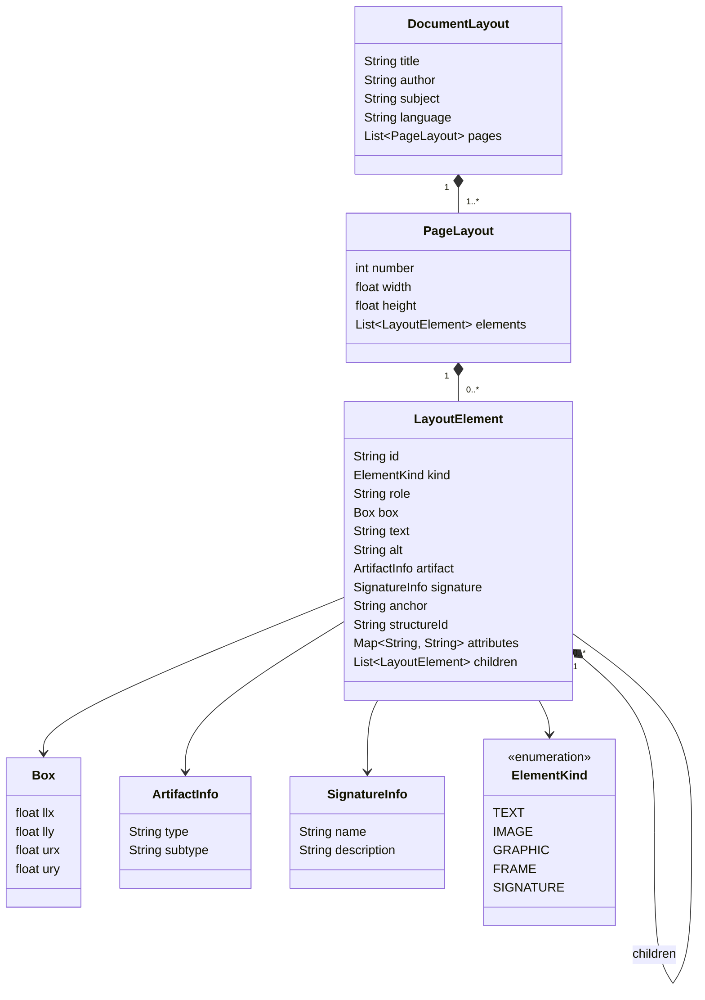
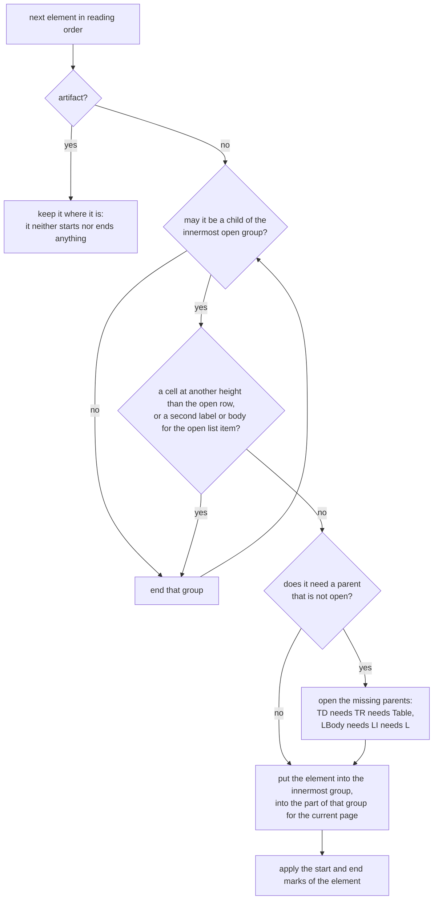
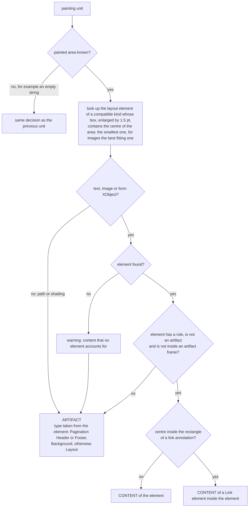
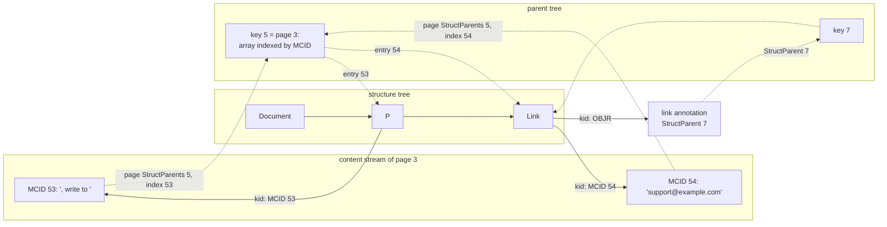
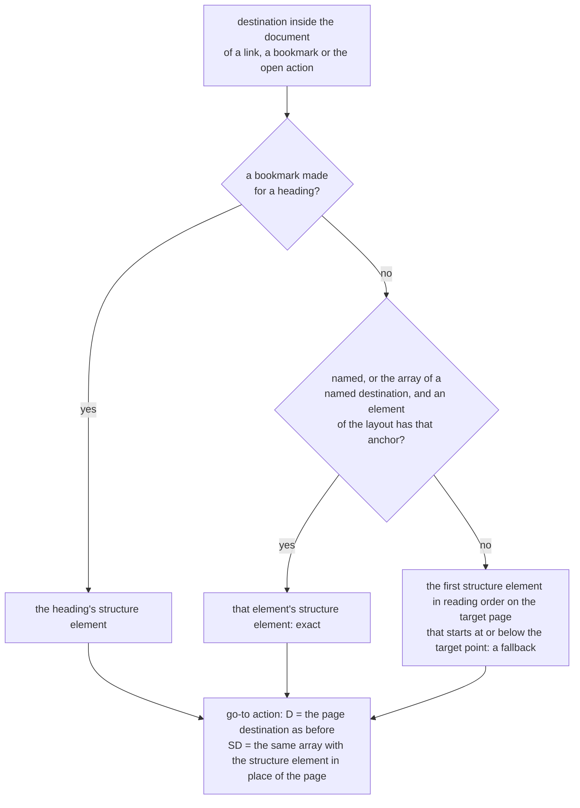

# Architecture

How an untagged JasperReports PDF becomes a PDF/UA document, PDF/UA-1 or PDF/UA-2. This document follows the data
from the template to the finished file and quotes real output of the demo
([docs/sample-output](sample-output)) wherever it can.

- [1. The problem in PDF terms](#1-the-problem-in-pdf-terms)
- [2. The flow](#2-the-flow)
- [3. Code structure](#3-code-structure)
- [4. The layout: the contract between the two halves](#4-the-layout-the-contract-between-the-two-halves)
- [5. The JasperReports half](#5-the-jasperreports-half)
- [6. The post-processor, step by step](#6-the-post-processor-step-by-step)
- [7. PDF/UA-1 and PDF/UA-2](#7-pdfua-1-and-pdfua-2)
- [8. Signing](#8-signing)
- [9. Design decisions](#9-design-decisions)

## 1. The problem in PDF terms

A page of a PDF is a *content stream*: a list of drawing operators such as "select this font",
"show these glyphs here", "stroke a line from A to B", "paint this image". Nothing in it says
that some glyphs are a heading and a line is decoration. A tagged PDF adds that information in
four places, and PDF/UA requires all of them:

| Piece | What it is | Where it lives |
|---|---|---|
| **Marked content** | brackets around operators: `/P <</MCID 3>> BDC ... EMC`. The number (MCID) identifies the bracket within its page. | page content stream |
| **Artifact marking** | the same brackets with the tag `/Artifact`, for everything that is not real content | page content stream |
| **Structure tree** | a tree of *structure elements* (`Document`, `H1`, `P`, `Figure`, `Link`, ...). Leaves point to marked content by MCID, or to annotations through object references (`OBJR`). Its depth-first order is the reading order. | `StructTreeRoot` in the document catalog |
| **Parent tree** | the reverse index: from (page, MCID) or from an annotation back to its structure element | `ParentTree` in the `StructTreeRoot` |

On top of that come document level entries: the PDF/UA identifier in the XMP metadata, a title
that viewers display, the document language, and so on.

JasperReports Community Edition 7.1.1 writes none of these. The post-processor has to add all
of them to a file that was never meant to be tagged, without changing how it looks.

## 2. The flow



The two intermediate files are the complete input of the post-processor. It can run later, on
another machine, without JasperReports on the classpath
(`PostProcessorFromFilesTest` does exactly that). Signing is a separate step again: it needs a
PDF with an empty signature field and nothing else from this project.

## 3. Code structure

About 4,500 lines of Java in five packages, plus about 1,900 lines of tests.



Two rules keep the halves apart, and the imports obey them today:

- `postprocess`, `layout` and `sign` never import `net.sf.jasperreports`;
- `jasper` and `layout` never import `org.apache.pdfbox`;
- `sign` imports nothing from the other packages of the project.

| Class | Responsibility |
|---|---|
| `PdfUaPipeline` | runs the flow, names the output files |
| `jasper.JasperReportGenerator` | compile the JRXML, fill it (one empty record), export with `JRPdfExporter` |
| `jasper.JasperLayoutExtractor` | `JasperPrint` → `DocumentLayout`; interprets the `pdfua.*` and JasperReports tagging properties and the defaults |
| `jasper.LayoutAssembler` | nests the elements: cells into rows and tables, items into lists, across page breaks; scope of header cells; repeated header rows |
| `layout.*` | records describing pages and elements; `LayoutJson` reads and writes them |
| `postprocess.PdfUaPostProcessor` | preconditions, per-page tagging, catalog entries, metadata, bookmarks, saving; for the part of PDF/UA chosen with `PdfUaPart` |
| `postprocess.ContentScanner` | PDFBox stream engine that reports what each operator paints and where |
| `postprocess.PageTagger` | content or artifact decision, marked content, links, structure elements of one page |
| `postprocess.StructureBuilder` | structure elements as COS dictionaries, parent tree, role map, namespaces; remembers which structure element represents which layout element |
| `postprocess.StructureTypes` | how a role of the layout is written in PDF/UA-2: type and namespace |
| `postprocess.StructureDestinations` | PDF/UA-2: structure destinations for links and bookmarks inside the document |
| `postprocess.SignatureFields` | empty signature fields with name and description |
| `postprocess.XmpMetadata` | the XMP packet |
| `postprocess.StructureDump` | text view of the structure tree and artifacts of any tagged PDF |
| `sign.PdfSigner` | signs a signature field as an incremental update, with a visible signature and an updated description |
| `sign.SigningIdentity` | key and certificate chain; can create a throw-away self-signed one |

## 4. The layout: the contract between the two halves



- **`kind`** says what the element draws, which limits what page content can belong to it: text
  runs only match `TEXT` elements, images and form XObjects only `IMAGE` elements.
- **`role`** is the structure type (`H1`, `P`, `Figure`, ...), the pseudo role `Artifact`, or
  `null` for a frame that only positions its children.
- **`box`** is in PDF user space: points, origin at the lower left corner of the page. The
  extractor converts from the report's top-left coordinates, so the post-processor never has to.
- **`artifact`** classifies an artifact (`Pagination`/`Header`, `Pagination`/`Footer`, `Layout`,
  `Background`). It is also set on *real* content that lives in a page header or footer (the
  first-page logo), so that the borders or underlines of such an element get the right type.
- **`text`** is informational only. The post-processor takes the text it needs from the PDF.
- **`anchor`** is the name under which links inside the document point to the element (the
  `anchorNameExpression` of the template). PDF/UA-2 needs it to find the structure element a
  link leads to.
- **`structureId`** joins the parts of one structure element. A table that runs over two pages
  appears in the layout once per page; both parts carry the same id and become a single `Table`.
- **`attributes`** are further properties of the structure element: `Scope`, `ColSpan`,
  `RowSpan` and `Summary` for tables, `ListNumbering` for lists, `Lang` and `ActualText` for any
  element (`layout/Attributes.java`).
- **`kind` = `FRAME`** is either a frame of the report or a group that exists only in the
  structure, such as a table row put together from its cells. Such a group has no box of its own;
  it gets the box that encloses its children.
- The order of `elements` (and of `children`) **is the reading order**.

The logo on the first page of the demo, as written to `01-jasper-layout.json`:

```json
{
  "id" : "p1-2",
  "kind" : "IMAGE",
  "role" : "Figure",
  "box" : { "llx" : 50.0, "lly" : 766.0, "urx" : 182.0, "ury" : 806.0 },
  "alt" : "Aurora Data Services logo",
  "artifact" : { "type" : "Pagination", "subtype" : "Header" }
}
```

On page 2 the same template element has `"role" : "Artifact"`.

## 5. The JasperReports half

### Configuration

`src/main/resources/jasperreports.properties` holds the three settings the flow depends on:

```properties
# never throw "Tagged PDF export is not supported"; every tagging call becomes a no-op
net.sf.jasperreports.export.pdf.tagger.factory=net.sf.jasperreports.pdf.common.SilentPdfTaggerFactory
# copy element properties that start with "pdfua." from the template to the filled report
net.sf.jasperreports.print.transfer.pdfua=pdfua.
# fail instead of silently falling back to a font that is not embedded
net.sf.jasperreports.awt.ignore.missing.font=false
```

Without the second line the hints would never reach the `JasperPrint`: JasperReports only
transfers element properties whose names start with a registered prefix.

When a report does not ask for tagging, JasperReports picks the silent tagger by itself. The
first line matters for templates that contain `net.sf.jasperreports.export.pdf.tagged=true`
(common in templates written for older versions): with the default factory the export throws,
with the silent one it writes an empty structure tree, which the post-processor replaces
(`SilentTaggerTest`).

### What the raw PDF already has

Not everything is missing. JasperReports writes the document title into the information
dictionary, embeds the DejaVu fonts (because they come from a font extension) with a Unicode
mapping, creates the link annotations for hyperlinks, and in this setup already writes `/Lang`
and the tab order entry. The veraPDF report for the raw file shows what is left: no structure
tree, no marked content at all (930 content items), no metadata stream, untagged links.

### Two vocabularies

The extractor understands the `pdfua.*` properties of this project and the tagging properties
that JasperReports defines for its own tagger. The second set matters for two reasons: templates
that were prepared for the JasperReports tagger keep working, and the **table component writes
these properties by itself** when `net.sf.jasperreports.components.table.accessible` is set.

| JasperReports property | Values | Meaning here |
|---|---|---|
| `net.sf.jasperreports.export.pdf.tag.table`, `.tr`, `.th`, `.td`, `.l`, `.li`, `.lbl`, `.lbody`, `.h1`..`.h6`, `.note`, `.reference` | `start`, `end`, `full` | a group of that type starts or ends with the element; `full`: the element is the whole group |
| `net.sf.jasperreports.export.pdf.tag.colspan`, `.rowspan` | number | span of a cell |
| `net.sf.jasperreports.export.accessibility.tag` | `h1`..`h6`, `artifact`, `table`, `columnheader`, `rowheader`, `note`, `reference` | role; for the two header values also the scope of the header cell |
| `net.sf.jasperreports.export.pdf.tag.language` | language tag | on an element: its language |
| `net.sf.jasperreports.export.pdf.tag.attribute.ActualText` | text | replacement text of the element |

The names and the `start`/`end`/`full` protocol are taken from the JasperReports sources and
documentation. How the commercial tagger treats every corner case is not known; what is
implemented here is described below.

### Layout extraction

`JasperLayoutExtractor` walks the pages of the `JasperPrint`. For every print element it
decides, in this order:

| Step | Condition | Result |
|---|---|---|
| 1 | `pdfua.signature.name` is set | kind `SIGNATURE`, role `Form`; a missing `pdfua.signature.description` is an error |
| 2 | `pdfua.role` is set | that role (an unknown one is an error) |
| 3 | a JasperReports tag property is `full`, or `...accessibility.tag` is set | the corresponding type; with several `full` values the innermost is the element itself and the outer ones are groups around it |
| 4 | text element | `Artifact` in the page header, page footer or background band, otherwise `P` |
| 4 | image element | `Figure` if it has alternate text and is not in one of those bands, otherwise `Artifact`; a `Figure` without alternate text is an error |
| 4 | frame | no role: children are handled individually |
| 4 | line, rectangle, ellipse, anything else | `Artifact` |

The alternate text of an image is `pdfua.alt` or, following the JasperReports convention, its
hyperlink tooltip. The band an element comes from (`JRPrintElement.getOrigin()`) decides the
artifact type. Children of a frame are positioned relative to the frame plus its padding; the
extractor resolves that to absolute boxes.

Only the bands of the report itself count for the "page header, page footer or background"
rule. The table component builds its column footer as the page footer of an inner report; that
is content of the table, not a pagination artifact.

Document title, author, subject and language come from the standard report properties
(`net.sf.jasperreports.export.pdf.metadata.*`, `net.sf.jasperreports.export.pdf.tag.language`).

### Assembling rows, tables and lists

A report is flat. The cells of a table are siblings of the paragraph before it, and a table
that runs over three pages is three unrelated runs of cells with page headers in between. A
tagged PDF needs `Table > TR > TH/TD` and `L > LI > Lbl/LBody`, each table and list exactly
once. `LayoutAssembler` reads the elements of **all pages in order** and builds that nesting.



Three sources of nesting can be mixed freely:

- **Frames with a role** are groups as they are: a frame with `pdfua.role` = `LBody`, or the
  frame of a table component, which JasperReports marks `table=full`.
- **Start and end marks** (the JasperReports protocol) open and close groups explicitly.
- **Missing parents are added.** A cell that is not in a row gets a row; cells that start at
  the same height on the same page share it. A row that is not in a table gets a table. The same
  for list labels and bodies, items and lists. Such a group ends by itself as soon as an element
  arrives that cannot be its child: a paragraph after the last row ends the table.

So a plain report needs nothing but `pdfua.role` = `TH` or `TD` on its cells, and a list nothing
but `Lbl` and `LBody`. `TabularReportTest` runs the same three-page report marked in both ways
and expects the same structure.

**Across pages.** Groups stay open over a page break. Page headers and footers are artifacts,
so they do not end anything, and the first row on the next page continues the table. In the
layout the table then has one part per page with a common `structureId`. A frame that
JasperReports splits at a page break (the table component does this) is recognised as the
continuation of the group closed last when it comes from the same template element and only
artifacts lie in between.

**Repeated header rows.** JasperReports prints column headers again on every page. The
assembler remembers the text of the header rows at the start of a table (the leading rows that
consist of `TH` cells only). When the first rows on a continuation page have the same text,
they are that repetition and become pagination artifacts: a reader hears the headers once.

**Header scope.** A `TH` without an explicit scope gets `Column` when its whole row consists of
header cells and `Row` otherwise.

**Captions.** An element with the role `Caption` directly before a table becomes the first
child of the table.

**List numbering.** If the template does not state it, `ListNumbering` is read from the label
of the first item: `1.` is `Decimal`, `a)` is `LowerAlpha`, a bullet is `Disc`, and so on.

### What the table component delivers

For the price table of the demo, JasperReports produces one frame per page for the table and,
inside it, one frame per cell. With `components.table.accessible` the table frame carries
`table=full`, each cell `th=full` or `td=full`, the first and last cell of a row `tr=start` and
`tr=end`, and cells that span carry `colspan`/`rowspan`. Three things were learnt by reading
the JasperReports source and the generated layout:

- Properties written on a *cell* in the JRXML are not passed on to the cell frame. To make a
  body cell a row header, `pdfua.role` = `TH` is put on the text inside the cell; the extractor
  moves it to the cell when the text is the only content of the cell.
- Column footers are printed at the bottom of every page with the running values. The totals
  row of the demo is therefore a `tableFooter`, which is printed once.
- Header texts and footers come from bands of an inner report (see the band rule above).

## 6. The post-processor, step by step

### 6.1 Preconditions

`PdfUaPostProcessor` refuses to start when something cannot be repaired afterwards:

- the page count differs from the layout;
- there is no title or no language;
- the document is encrypted;
- a font is not embedded (checked for every page, including the resources of form XObjects).

### 6.2 Scanning: what does each operator paint?

`ContentScanner` extends PDFBox's `PDFGraphicsStreamEngine`. PDFBox interprets the stream
(graphics state, text matrices, fonts); the scanner listens and records two things:

- every page level operator with its operands, exactly as read, so the stream can be written
  back unchanged;
- the *painting units*: runs of operators that put marks on the page, with the bounding box of
  what they paint in page coordinates.

| Unit kind | Operators | Bounding box from |
|---|---|---|
| `TEXT` | one text showing operator (`Tj`, `TJ`, `'`, `"`) | the glyphs: origin and advance of each, with an assumed ascent of 0.8 and descent of 0.2 of the font size |
| `IMAGE` | `Do` of an image XObject, inline image | the unit square under the current transformation matrix |
| `FORM` | `Do` of a form XObject (how JasperReports draws SVG images) | the form's `BBox` under its matrix and the current transformation matrix |
| `PATH` | everything from the first construction operator (`m`, `re`, ...) to the painting operator (`S`, `f`, `B`, ...) | the path |
| `SHADING` | `sh` | none |

Operators *inside* a form XObject are not units of their own: the `Do` that paints the form is
one unit. A path that is only used for clipping (`W n`) paints nothing and is no unit. For text
units the scanner also keeps the Unicode text, the font and the start and end points of the
baseline, and it remembers, per font, the character code that shows a space (needed in 6.4).

### 6.3 Matching: content or artifact?



Consequences of these rules:

- **Paths are always artifacts.** In a report, lines, borders, backgrounds and underlines never
  carry meaning. A path only looks up an element to learn *which kind* of artifact it is: the
  rule under the header is `Pagination/Header`, the bar next to the quotation is `Layout`.
- **Nothing stays unmarked.** Whatever is not content becomes an artifact; there is no third
  outcome. This is the property PDF/UA cares about most (veraPDF rule 7.1-3).
- **Kinds prevent wrong matches.** A text run can only belong to a text element, even if it sits
  inside the box of a frame or of an image.
- **Images match by overlap, not by size.** For an image or form XObject the element whose box
  fits the painted area best is taken (intersection over union). A watermark behind the whole
  page and a diagram in the middle of it both contain the centre of the page; with "smallest
  element wins" the watermark would have become part of the diagram.
- **Suspicious cases are reported**, not hidden: text or an image that no element accounts for is
  made an artifact *and* produces a warning, because real content may have been lost.

### 6.4 Restoring word spaces

JasperReports positions every line of a paragraph separately and drops the space at which it
wraps the line. Read back, the text of the first paragraph was
`...Aurora Data Services SRLprovides to the customer...`. Software that guesses word boundaries
from glyph positions copes with that; software that reads the text of the tags literally does
not.

For two consecutive text units of the same element, the post-processor adds a space when

- the second starts on another line (baseline differs by more than 0.5 pt, or it starts left of
  where the first ended), and
- the first does not end with white space or a hyphen (`-`, soft hyphen, U+2010), and the second
  does not start with white space.

The space is a real glyph: one more `Tj` with the space code of the font, right after the last
operator of the line. It is invisible and moves nothing, because every line starts with an
absolute text matrix. In the demo this happens 19 times.

### 6.5 Grouping and numbering

Consecutive units with the same target form one marked-content sequence, unless one of these
operators lies between them: `BT`, `ET`, `q`, `Q`, `BMC`, `BDC`, `EMC`. That keeps every
sequence inside one text object and one graphics state level, as the PDF specification
requires. Content sequences are numbered 0, 1, 2, ... per page: the MCIDs.

A paragraph therefore usually consists of several sequences (JasperReports writes one text
object per text element, but an inline link splits it). A structure element can own any number
of them.

### 6.6 Rewriting the content stream

The recorded operators are written back in order, with `BDC` before the first operator of each
group and `EMC` after the last. Nothing else changes; the new stream replaces the page contents.
Part of page 3 of the demo, before:

```text
BT
1 0 0 1 50 458.72 Tm
/F2 10 Tf
0.10196 0.10196 0.10196 rg
(...Our support team answers ... Open a ticket on...) Tj
0 g
1 0 0 1 50 447.08 Tm
0.02353 0.27059 0.67843 rg
(...www.example.com/support...) Tj
0 g
0.10196 0.10196 0.10196 rg
(..., write to ...) Tj
```

and after (strings are glyph codes in the file; shown here as the text they stand for):

```text
BT
1 0 0 1 50 458.72 Tm
/F2 10 Tf
0.10196 0.10196 0.10196 rg
/P <</MCID 51 >> BDC
(...Our support team answers ... Open a ticket on...) Tj
(...one space...) Tj                  % added: the space dropped at the line wrap
EMC
0 g
1 0 0 1 50 447.08 Tm
0.02353 0.27059 0.67843 rg
/Link <</MCID 52 >> BDC
(...www.example.com/support...) Tj
EMC
0 g
0.10196 0.10196 0.10196 rg
/P <</MCID 53 >> BDC
(..., write to ...) Tj
EMC
```

The start of the same page shows the artifacts: first the watermark from the background band,
then the logo. The logo is the form XObject `Xf2`; on page 1 the same `Do` is wrapped in
`/Figure <</MCID 0 >> BDC`:

```text
q
1 0 0 1 50 36 cm
/Artifact <</Type /Pagination /Subtype /Watermark >> BDC
/Xf1 Do
EMC
Q
...
q
1 0 0 1 50 766 cm
/Artifact <</Type /Pagination /Subtype /Header >> BDC
/Xf2 Do
EMC
Q
```

### 6.7 Building the structure

After the stream of a page is rewritten, `PageTagger` walks the layout elements of the page in
order and appends structure elements to the `Document` element:

- **Frame or group with a role** (`BlockQuote`, `Table`, `TR`, `L`, `LI`, ...): a grouping
  element; its children are built inside it. It is dropped if it ends up empty, except table
  cells: a table needs all its cells, also the empty ones.
- **Group with a `structureId`**: the structure element is created for the first part and
  reused for the others, so a table that continues on the next page is one `Table`.
- **Attributes** of the layout element are written: `Lang` and `ActualText` as entries of the
  structure element, the table and list attributes as attribute objects with the owners
  `Table` and `List`.
- **Note**: gets an `ID` that is unique in the document, and the structure tree root gets the
  `IDTree` that maps the ids to their elements.
- **Frame without a role**: transparent; children go to the current parent.
- **Artifact** (and everything inside an artifact frame): nothing.
- **Text or image with a role**: one structure element holding the MCIDs of its groups.
- **Figure**: additionally `Alt` and a `Layout` attribute object with the bounding box of what
  was actually painted.
- **Heading**: additionally remembered for the bookmarks.
- **Signature placeholder**: a signature field is created (6.9) and referenced from a `Form`
  element.

**Links.** A group that was matched to a link annotation goes into a `Link` element *inside*
the element that owns the text, together with an object reference to the annotation.
Consecutive link groups with the same target share one `Link` element; that is how a link that
wraps to the next line (two annotations in the PDF) stays one link for the reader. Every
annotation gets a `/Contents` description: the visible link text, followed by the target in
parentheses when the text does not already show it. A link to a place inside the document has
no address to show; its description is the link text. A link annotation that covers no tagged
text is still put into a `Link` element (PDF/UA requires it) and reported as a warning.

A header cell and a list of the sample, as stored in `02-pdfua.pdf`:

```text
361 0 obj                          523 0 obj                 100 0 obj                312 0 obj
<< /Type /StructElem               << /Scope /Column         << /Type /StructElem     << /ListNumbering /Disc
   /S /TH                             /RowSpan 2                /S /L                    /O /List
   /A 523 0 R                         /O /Table                 /A 312 0 R            >>
   /K [140 0 R]                    >>                           /K [313 0 R 314 0 R 315 0 R]
   /P 321 0 R                                                   /P 57 0 R
>>                                                           >>

106 0 obj                          111 0 obj                 46 0 obj (structure tree root)
<< /Type /StructElem               << /Type /StructElem      << /Type /StructTreeRoot
   /S /Note                           /S /P                     /K [57 0 R]
   /Pg 54 0 R                         /Pg 54 0 R                /ParentTree 58 0 R
   /ID (note-0001)                    /Lang (ro-RO)             /RoleMap 59 0 R
   /P 57 0 R                          /P 57 0 R                 /IDTree 60 0 R      % << /Names [(note-0001) 106 0 R] >>
   /K [48]                            /K [59]                >>
>>                                 >>
```

The paragraph from 6.6, as stored in `02-pdfua.pdf` (object numbers from the sample file):

```text
109 0 obj                                 290 0 obj
<< /Type /StructElem                      << /Type /StructElem
   /S /P                                     /S /Link
   /Pg 54 0 R                                /Pg 54 0 R
   /P 57 0 R                                 /P 109 0 R
   /K [51 289 0 R 53 290 0 R 55 291 0 R 57]  /K [54 511 0 R]
>>                                        >>

511 0 obj                                 78 0 obj
<< /Type /OBJR                            << /Type /Annot /Subtype /Link
   /Obj 78 0 R                               /A << /S /URI /URI (mailto:support@example.com) >>
   /Pg 54 0 R                                /Rect [234.91 447.08 350.95 457.08]
>>                                           /F 4 /Border [0 0 0] /C [0 0 1]
                                             /StructParent 7
                                             /Contents (support@example.com)
                                          >>
```

The paragraph (`109`) owns the marked content 51, 53, 55 and 57 and three `Link` children. The
`Link` (`290`) owns marked content 54, the e-mail address, and the annotation.

### 6.8 The parent tree



Each page with tagged content gets a key (`/StructParents`); its parent tree entry is an array
with one structure element per MCID. Each tagged annotation gets its own key
(`/StructParent`). The real thing, shortened:

```text
58 0 obj
<< /Nums [ 0 [83 0 R 84 0 R 85 0 R ... ]        % page 1: one entry per MCID
           1 121 0 R  2 121 0 R                 % the two annotations of the wrapped link on page 1
           3 [ ... ]                            % page 2
           4 ...                                % the link inside the document, on page 2
           5 [ ... 109 0 R 289 0 R 109 0 R 290 0 R 109 0 R 291 0 R 109 0 R ... ]   % page 3
           6 289 0 R  7 290 0 R  8 291 0 R  9 292 0 R     % link annotations of page 3
           10 116 0 R  11 119 0 R ]             % the two signature widgets -> Form elements
>>
```

`StructureBuilder` writes structure elements directly as COS dictionaries instead of using
PDFBox's typed classes. The result is the plain structure described in ISO 32000-1, 14.7, and
it is easy to compare with a dump of the file.

### 6.9 Signature fields

For every placeholder `SignatureFields` creates a `PDSignatureField`:

```text
55 0 obj
<< /FT /Sig /Type /Annot /Subtype /Widget
   /T (CustomerSignature)
   /TU (Customer signature. By signing here you confirm that you have read this summary and
        that you accept Service Agreement SA-2026-0042.)
   /Rect [50.0 144.0 285.0 204.0]
   /F 132                    % print + locked (PDFBox default for signature widgets)
   /P 54 0 R  /AP 81 0 R
   /StructParent 10
>>
```

- `/TU` is the description from the template. It is what assistive technology announces when
  the field receives focus, and what PDF/UA-1 7.18.4 asks for.
- The widget rectangle is the box of the placeholder element, so the field sits exactly on the
  rectangle the report drew. The rectangle itself is a path, hence an artifact.
- The appearance stream is empty: an unsigned field shows nothing of its own.
- The `Form` structure element is created at the position of the placeholder in the reading
  order. The template puts the visible statement of what is being signed directly before the
  placeholder, so a reader gets: statement, then field.

The post-processor leaves the fields empty. Signing is a separate step: section 8. For PDF/UA-2
the widget also gets a `/Contents` entry: section 7.

### 6.10 Document level

| Entry | Value | Why |
|---|---|---|
| `StructTreeRoot` | the tree, parent tree and role map (`Title` → `P`) | tagged PDF |
| `MarkInfo` | `/Marked true` | the file declares itself tagged |
| `Lang` | from the layout | natural language of all text |
| `ViewerPreferences/DisplayDocTitle` | `true` | viewers show the title, not the file name |
| `Metadata` | XMP with `pdfuaid:part` = 1 (PDF/UA-2: 2, and `pdfuaid:rev` = 2024), `dc:title`, creator, description, language, dates | PDF/UA identification and title |
| information dictionary | title, author, subject, dates, producer (`...; pdf-ua-tagging-poc`) | consistent with the XMP |
| `Tabs` on every page | `/S` | tab order follows the structure |
| `Version` | 1.7 (PDF/UA-2: 2.0, in the header as well) | PDF/UA-1 is defined on PDF 1.7, PDF/UA-2 on PDF 2.0 |
| `Outlines` | one bookmark per heading, nested by level, each with a destination and a link to its structure element (`SE`); for PDF/UA-2 a structure destination too | navigation |

`Title` is not a standard structure type in PDF 1.7 (it is one in PDF 2.0), which is why the
role map exists: `Title` is declared equivalent to `P`.

### 6.11 Saving

The document is saved in full (not incrementally) and without object streams
(`CompressParameters.NO_COMPRESSION`). The file is a few kilobytes larger, and every object
can be read in a text editor or found with `grep -a`. Content streams stay Flate compressed.

## 7. PDF/UA-1 and PDF/UA-2

`PdfUaPostProcessor.process(raw, layout, target, part)` writes either part from the same layout;
`PdfUaPart.PDF_UA_1` is the default. Everything in section 6 is the same for both: the matching,
the marked content, the artifacts, the nesting, the parent tree. A test compares the two tag
trees and finds the same elements with the same text in the same order. What differs is how the
document declares itself and how some of the structure is written.

Before any code for PDF/UA-2 was written, the rules of the veraPDF PDF/UA-2 profile (92 rules
of ISO 14289-2 and 1,636 nesting rules of ISO 32005) and the veraPDF code behind the relevant
ones were read. The design follows from what they check.

### What changes

The PDF/UA-1 output, validated with the PDF/UA-2 profile, fails 8 rules. Each is one difference:

| veraPDF rule | PDF/UA-2 requires | The PDF/UA-2 output has |
|---|---|---|
| 6.1-1 | PDF 2.0 | header `%PDF-2.0` and catalog `/Version /2.0` |
| 5-2, 5-5 | `pdfuaid:part` 2 and `pdfuaid:rev` 2024 in the XMP | both |
| 8.2.5.2-2 | the `Document` element in the PDF 2.0 namespace | a namespace on every structure element |
| 8.2.5.14-1 | no `Note` (unless role mapped into PDF 2.0) | `FENote` |
| 8.8-1, 8.8-2 | destinations inside the document are structure destinations | an `SD` on bookmarks and internal links |
| 8.10.2.3-1 | a widget without a label in its `Form` element has `Contents` | `Contents` on the signature widgets |

### Structure types and namespaces

In PDF 2.0 a structure element can say which set of types its `/S` comes from: `/NS` points to a
namespace dictionary, and the structure tree root lists all of them in `/Namespaces`
(ISO 32000-2:2020, 14.8.6). The layout keeps speaking PDF 1.7 types; `StructureTypes` translates:

| Role in the layout | PDF/UA-1 | PDF/UA-2 |
|---|---|---|
| `Title` | `Title`, role mapped to `P` | `Title` in the PDF 2.0 namespace, which defines it; `P` in the fallback role map for older readers |
| `Note` | `Note` with an `ID` | `FENote` in the PDF 2.0 namespace, `ID` kept; `Note` in the fallback role map |
| `BlockQuote`, and the other PDF 1.7 types that PDF 2.0 dropped (`Art`, `Quote`, `Code`, `Reference`, ...) | as is | as is, in the PDF 1.7 namespace |
| `H` | `H` | refused: ISO 14289-2, 8.2.5.12 forbids it |
| `TOCI` | `TOCI` | refused: 8.2.5.8 requires a `Ref` to the target, which the layout cannot express |
| everything else | as is | as is, in the PDF 2.0 namespace |

`BlockQuote` could also have become a PDF 2.0 `Div` or `Aside`. Rule 8.2.4 allows the PDF 1.7
namespace, and keeping it keeps the meaning. `FENote` gets no `NoteType` attribute, so it has
the default `None`. PDF/UA-2 asks for `Ref` entries in both directions between a footnote and
the text that cites it (8.2.5.14-2, -3), but nothing in the demo cites its note, and the layout
has no way to say that one element cites another.

None of the parent-child combinations the demo produces is forbidden by ISO 32005, whose rules
veraPDF checks as part of the PDF/UA-2 profile.

**A fallback for readers without PDF 2.0 support.** The first version of the PDF/UA-2 output
had no role map. veraPDF accepted it, but poppler 26.02 (`pdfinfo -struct-text`) reported
`StructElem object is wrong type` for `Title` and `FENote` and left both elements out of the
tree, text included. A reader built on such a library would never have heard the document
title or the note. Software of that age ignores `/NS` and looks unknown types up in the role map
of the structure tree root, so the root now maps `Title` to `P` and `FENote` to `Note`. A PDF 2.0
processor applies that role map only to elements outside an explicit namespace and is not
affected: veraPDF gives the same result with and without it, as its source code predicts.
poppler now reads exactly the same tree as from the PDF/UA-1 file. LaTeX's tagpdf ("store into
the pdf 1.7 rolemapping so that we can add that as fallback for pdf 1.7 processor") and Typst's
pdf-writer ("for PDF 2.0 documents, ... this mapping maps to the PDF 1.7 roles") do the same.

The objects, from the sample file:

```text
46 0 obj  << /Type /StructTreeRoot  /K [57 0 R]  /ParentTree 58 0 R  /ParentTreeNextKey 12
             /RoleMap 59 0 R  /Namespaces [60 0 R 61 0 R]  /IDTree 62 0 R >>
59 0 obj  << /Title /P /FENote /Note >>                       % for readers that ignore namespaces
60 0 obj  << /Type /Namespace /NS (http://iso.org/pdf2/ssn) >>
61 0 obj  << /Type /Namespace /NS (http://iso.org/pdf/ssn) >>
57 0 obj  << /Type /StructElem /S /Document   /NS 60 0 R /P 46 0 R /K [...] >>
86 0 obj  << /Type /StructElem /S /Title      /NS 60 0 R /Pg 52 0 R /P 57 0 R /K [1] >>
108 0 obj << /Type /StructElem /S /FENote     /NS 60 0 R /Pg 54 0 R /ID (note-0001) /P 57 0 R /K [48] >>
97 0 obj  << /Type /StructElem /S /BlockQuote /NS 61 0 R /K [124 0 R] /P 57 0 R >>
```

### Structure destinations

A structure destination (ISO 32000-2:2020, 12.3.2.3) is a destination array with a structure
element in place of the page. It goes into the `SD` entry of a go-to action (12.6.4.2); the page
destination stays in `D` for readers that do not know PDF 2.0. veraPDF accepts a go-to action as
soon as it has an `SD`, and a plain `Dest` only if that destination itself is a structure
destination, so bookmarks and links with a `Dest` are given a go-to action instead.



JasperReports writes a named destination for every anchor of a template and lets the link's
action point to the same destination array. `StructureDestinations` recognises that array, takes
its name, and finds the layout element with that anchor. The fallback serves links to a page
(`linkType="LocalPage"`), whose destination is the top of the page. A destination for which no
structure element is found produces a warning; veraPDF would then reject the file.

The bookmark and the link of the sample that lead to section 4.1:

```text
301 0 obj  << /Title (4.1 Signatures) /A 525 0 R /SE 116 0 R /Parent 64 0 R /Count 0 >>
525 0 obj  << /Type /Action /S /GoTo /D [54 0 R /XYZ 50 296 null] /SD [116 0 R /XYZ 50 296 null] >>

77 0 obj   << /Subtype /Link /Rect [74 502.72 244 512.72] ...
              /A << /S /GoTo /D 65 0 R /SD [116 0 R /XYZ 50 296.86 0] >>     % 65 0 R: [54 0 R /XYZ 50 296.86 0]
              /StructParent 4 /Contents (Sign the agreement in section 4.1) >>

116 0 obj  << /Type /StructElem /S /H2 /NS 60 0 R /Pg 54 0 R /P 57 0 R /K [62] >>   % "4.1 Signatures"
```

### Signature widgets

PDF/UA-2 wants a widget described either by a `Lbl` structure element inside its `Form` element
or by `Contents` (8.10.2.3). The visible statement before each signature field is a paragraph of
its own, so the widget gets `Contents` with the same text as `TU`. When the field is signed,
`PdfSigner` appends the "Signed by ..." sentence to both.

## 8. Signing

`PdfSigner` signs one of the empty fields. It works on any PDF with an empty signature field;
the demo signs `CustomerSignature` with a certificate made up on the spot
(`SigningIdentity.selfSigned`).

**Incremental update.** The signed file is the unsigned file, byte for byte, plus an appended
section with the changed objects and the signature. That is what a PDF signature needs (a second
signature must not invalidate the first), and it means the structure tree and all marked content
are literally untouched. `SignedDocumentTest` checks both: the first bytes of the signed file
are the unsigned file, and a second signature can be added after the first.

**The existing field is signed**, not a new one. The field already sits in a `Form` structure
element, after its label in the reading order, with `/StructParent` and `/TU`; signing only adds
the signature value (`/V`) and an appearance.

**The visible signature** is an appearance stream with a few lines of text. PDF/UA requires the
font to be embedded, here as elsewhere. PDFBox can only embed a subset of a font when it writes
a whole document, not in an incremental update, so the appearance is built in a small separate
PDF, which PDFBox then copies the appearance from. Its content is marked as an artifact.

**The description says that the field is signed.** The text of the visible signature is not
part of the tag tree. So the sentence that the sighted reader sees ("Signed by Demo Customer on
17 November 2026") is appended to the description of the field:

```text
/TU (Customer signature. By signing here you confirm that you have read this summary and that
     you accept Service Agreement SA-2026-0042. Signed by Demo Customer on 17 November 2026.)
```

All wording is passed in by the caller (`PdfSigner.Wording`), so it can follow the language of
the document.

**The signature itself** is a detached CMS (PKCS#7) container, SHA-256 with RSA, built with
Bouncy Castle, in the classic `adbe.pkcs7.detached` format. There is no time stamp, no
revocation information and no certification (DocMDP) level. Those are needed for signatures
that have to stand up later; adding them does not interact with the tagging.

## 9. Design decisions

**Post-process instead of implementing JasperReports' `PdfTagger` interface.** The interface is
public, so a tagger could be written inside the export. It was not chosen because the goal was
a PDF/UA step at the *end* of the flow that does not depend on exporter internals; the interface
is new (7.0.8) and its implementation was just removed from the open source code base, so its
stability is unknown; and JasperReports itself says the link annotation tagging needs its
patched OpenPDF build. The price is the geometric matching described above. Nobody measured
whether an own `PdfTagger` would have been simpler; it is the obvious alternative to evaluate.

**A layout file instead of guessing from the PDF.** Heading levels, alternate texts and "this
logo is decoration on page 2" cannot be derived from drawing operators. The filled report has
this information and exact coordinates, so the post-processor never guesses meaning. It only
has to answer "which element painted this?".

**Matching by the centre of the painted area.** Simple and independent of the order in which
the exporter writes things. It relies on elements not overlapping and on each text showing
operator belonging to a single element, which is how JasperReports with OpenPDF writes text
(one `Tj` per styled chunk and line).

**A real space instead of `ActualText`.** `ActualText` on each line would also fix the missing
word spaces, but it replaces the text of the line for every consumer and has to be kept correct
for every glyph. One space glyph per line end changes nothing else.

**`Title` mapped to `P`.** The alternative, tagging the document title as `H1`, would have
pushed all section headings down a level or produced two competing first-level headings. A role
mapped type keeps the meaning visible in the tag tree and standard for a PDF 1.7 reader.

**Link descriptions are derived, not authored.** `/Contents` is mandatory for link annotations
in PDF/UA-1. JasperReports styled text offers no place to write one for an inline link, so it
is built from the link text and the target. It needs no translation because it contains no
words of its own.

**Stock OpenPDF.** `jasperreports-pdf` 7.1.1 depends on `openpdf 1.3.43.jaspersoft.2`, which
is not on Maven Central. The POM replaces it with the stock 1.3.43. JasperReports then logs
"Stock OpenPDF detected, link annotation /StructParent tagging is disabled" on every start;
`JasperReportGenerator` silences that one logger, because linking annotations to the structure
tree is the post-processor's job here.

**veraPDF as the automated check.** PAC has no command line and runs only on Windows. veraPDF
implements the machine-checkable PDF/UA-1 conditions and runs inside the unit tests. It is a
stand-in, not a replacement: see [verification.md](verification.md).

**Understand the JasperReports tagging properties.** The alternative was a vocabulary of this
project only. Reading the official one costs little, existing templates keep their marks, and
the table component, the usual way to put a table into a document-like report, needs one report
property instead of a mark on every cell.

**Nesting is worked out in the extractor, not in the post-processor.** Turning cells into rows
by their height is a guess about the template, and guesses belong on the side that knows the
report. The result is written into the layout as explicit groups, where it can be read and
corrected; the post-processor still only does what the layout says.

**Repeated header rows are recognised by their text.** JasperReports gives no reliable mark for
"this row is a reprint". Comparing with the header rows at the start of the table is
independent of how the table was built (component or bands). A table whose first data row on a
new page happens to equal its header row would be misread; that is accepted.

**Split frames are joined by their template element.** JasperReports does not mark the second
part of a frame that was split at a page break either. Same template element, later page,
nothing but artifacts in between: that is taken as a continuation. The same rule cannot be used
for text elements, because a detail band prints the same text element once per record, so a
text that is split across pages still becomes two paragraphs.

**PDF/UA-1 stays the default.** PAC, the checker the project targets, is documented for
PDF/UA-1; whether it validates PDF/UA-2 is not known. Readers and screen readers also differ in
how well they understand PDF 2.0 namespaces and types such as `Title` and `FENote`. PDF/UA-2 is
one parameter away for whoever needs it.

**One layout, two outputs.** The layout keeps the PDF 1.7 vocabulary, and the translation to
PDF/UA-2 happens where the structure elements are written. Templates do not change between the
two parts, and the tests can compare both outputs element by element.

**A fallback role map in a PDF 2.0 document.** It is not required, and a validator does not see
it. It is there because a real reader library dropped content without it.

**Keep the PDF 1.7 types that PDF 2.0 dropped, in their namespace.** Mapping `BlockQuote` to
`Div` would have been just as valid and would have lost the meaning. The exception is `Note`,
which PDF/UA-2 forbids and which has a direct successor, `FENote`.

**Structure destinations next to page destinations, not instead of them.** `D` keeps working in
readers that ignore `SD`. Nothing is lost for a reader that does not know PDF 2.0.

**Anchors are recorded in the layout.** The structure element behind a named destination could
have been guessed from the position of the destination. The layout knows it exactly, and a test
moves an anchor to another element to show that the exact path is the one taken.

**Refuse what cannot become valid.** `H` and `TOCI` in a template stop a PDF/UA-2 run with a
message. A file that would fail validation for a reason the template can fix is worse than none.

**The signed state goes into the field description.** A screen reader user should not depend
on the signature panel of a particular viewer to learn that a document is signed.

**Jackson comes along with JasperReports.** `LayoutJson` uses Jackson, which is on the
classpath only as a transitive dependency of `jasperreports`. If the post-processor is ever
moved into its own module, `jackson-databind` has to be declared there.
