# How this project was built

This repository was written by AI models in one conversation with one developer, on
17 November 2026: a first version in the morning, published-ready documentation after that, an
extension with tables, lists and digital signing later the same day, and finally support for
PDF/UA-2. The developer switched to another model for the last step. This document records what
was asked, which model did the work, what it did in which order, what went wrong on the way, and
how much of the result has been checked by anything other than the models themselves.

It is written by the models that did the work, from the conversation. Where it reports
something that could not be verified, it says so.

## Who did what

| | |
|---|---|
| **The developer** | wrote the nine prompts below; decided that the commercial JasperReports extensions are out, that PDF/UA has to be the last step of the flow, that intermediate files are kept, that the project is published, and that PDF/UA-1 stays the default with PDF/UA-2 as an option. Asked before publication, chose the Apache-2.0 licence and chose to keep the package name. As far as the conversation shows, did not edit any file. |
| **The models** | everything in the repository: build file, template, images, Java code, tests, documentation, this file. Also every technical decision not listed above. |
| **Nobody, so far** | a PAC run, a screen reader test, a review of the code or of the accessibility by a person. |

## Model and tools

- **Models**, both by Anthropic:
  - Claude Fable 5.2 (model id `claude-fable-5-2`) for prompts 1 to 8;
  - Claude Opus 5.5 (model id `claude-opus-5-5`) for prompt 9, PDF/UA-2.
- **Harness:** Claude Code, Anthropic's coding agent, running in a terminal on the developer's
  Mac. The model could read and write files in the project directory, run shell commands, and
  search and fetch web pages.
- **Effort setting:** before the fourth prompt the conversation shows a `/model` command that
  set "Fable 5.2" with `xhigh` effort. What the setting was during the initial build is not
  visible to the model. Before the ninth prompt two `/model` commands set "Opus 5.5", saved as
  the default for new sessions, and `max` effort for the rest of the session.
- **One conversation, no sub-agents.** The context was not reset between the prompts; the second
  model continued with the whole conversation, including the first model's work, in view.
- **Used on the machine:** Maven 3.8.4, JDK 21 and 17, `curl` (Maven Central metadata, source
  jars, release information), poppler (`pdfinfo`, `pdftoppm`, `pdftotext`, `pdfsig`), Docker
  (clean builds), a browser to render the diagrams, Python for throw-away scripts.

The model's training data ends before some of the library versions used here were released.
The versions were looked up at build time, as the first prompt asks: JasperReports 7.1.1 (on
Maven Central since 1 November 2026), PDFBox 3.0.8, veraPDF 1.30.4, JUnit 6.1.3, and later
Bouncy Castle 1.87.

## The prompts

Verbatim, in order. Prompts 2 and 3 arrived while the model was still working on prompt 1.

**Prompt 1: the task**

> In this project, in this folder, let's create a project for demonstrating PDF UA (Universal Accessibility).
> Create a Java project with Jasper. Use the latest version from Jasper. Use the latest one from the internet, not from the cutoff date of your LLM.
> It will be Java with Jasper. Create a simple Jasper template with:
> - a header
> - a title
> - a logo
> - some Heading 1
> - Heading 2
> - some text
> - some images
> - some links
> - a phone number
> - at least two pages
>
> Make sure that the logo from the header is only included in the PDF for the first page. The one on the second page should be marked as an artifact. Also include some horizontal lines and vertical lines that are also marked as artifacts, and so on. Include the signature field in the PDF.
> The purpose is to generate a PDF using Jasper and post-process it to add everything needed for PDFUA. Target the PAC checker as the verification tool. If you don't have access to it automatically, I can test it manually, but we need to make sure that:
> 1. everything is tagged
> 2. everything that should be marked as an artifact is marked as an artifact
> 3. everything that is a link, an email address, or a phone number is marked accordingly
>
> A screen reader should properly read that PDF, including signature fields. Also keep in mind, for the signature fields, to include a label above, behind, or under it to explain to the user what he's actually signing for.
> Add a unit test as necessary. Feel free to use any library you think is needed for post-processing, adding proper signature fields, tags, and so on.

**Prompt 2: sent a few minutes into the work**

> Also, when generating those PDFs, make sure you save the intermediate files, like the one that goes straight from Jasper and then the one that we post-process to add the PDFUA tags.

**Prompt 3: sent a few minutes later**

> Small note in case you haven't already discovered that as per https://github.com/Jaspersoft/jasperreports/releases#release-7.0.8 Tagging functionality was removed in some professional extensions, which we don't want to use. The goal would be to use the simple tagger, or something like that (the one that they recommend in the documentation), to silence the warnings and to do the tagging ourselves, but still keep the PDFUA at the end of the processing flow. We need to have the PDFUA, but we don't want to bother with the PDF extension/professional or whatever they call it.

**Prompt 4: after the first result**

> Is there any tool that can display the structure of those elements, similar to what PAC checker does, but something that works on macOS?

**Prompt 5**

> install/setup  PDFBox's PDFDebugger

**Prompt 6: preparing the publication**

> Let's prepare for publishing the project on GitHub.
> - Please remove any sensitive information.
> - Properly document the project as thoroughly as you can.
> - Target both humans and AI agents.
> - If possible, also include the initial prompt and the LLM model that we use to build it, and the process.
> - Be as transparent as you can about what we did, what works, and what doesn't.
> - Eventually include some Mermaid diagrams for how it works.
> - Go as deep as you can.

**Prompt 7: the extension**

> let's extend the PDF/UA to also include Tables,  lists, signatures and any other features that are relatively common to PDFs

**Prompt 8: a question about the tests**

> any reason we are using PDFAFlavour.PDFUA_1 and not PDFAFlavour.PDFUA_2 ?

**Prompt 9: after the answer, and after switching the model**

> yes, UA-1 default, add support for UA-2

## What happened, in order

```mermaid
flowchart TD
    A["Prompt 1: the task"] --> B["Look up current versions on Maven Central"]
    B --> C["Read the JasperReports 7.1.1 sources:<br/>can it tag PDFs by itself?"]
    C --> D{"Finding: the Community Edition<br/>tagger only throws"}
    P3["Prompt 3: the developer<br/>points to the same release note"] -.-> D
    D --> E["Plan: untagged export, layout from the filled report,<br/>PDFBox post-processor"]
    E --> F["Template, images, first raw export"]
    F --> G["Dump the content stream:<br/>how does JasperReports write text, links, images?"]
    G --> H["Post-processor"]
    H --> I["Read the tag tree, look at the rendered pages"]
    I --> J["Fix: dropped word spaces, a truncated caption"]
    J --> K["Tests and veraPDF"]
    K --> L{"veraPDF passes on the first run.<br/>Is it really checking?"}
    L --> M["Yes: the raw file fails 8 rules"]
    M --> N["Hardening: tagged=true templates,<br/>warnings for unlinked contact details"]
    N --> O["Prompts 4, 5: inspection tools, PDFDebugger"]
    O --> Q["Prompt 6: audit, clean build in a container,<br/>one bug found while documenting, documentation"]
    Q --> R["Prompt 7: read how the table component marks its cells"]
    R --> S["Assembler for rows, tables and lists;<br/>attributes; tables across pages"]
    S --> T["Signing, validated by veraPDF and by poppler"]
    T --> U["Tests for all of it, documentation again"]
    U --> V["Prompt 8: why not PDF/UA-2?<br/>The PDF/UA-1 file fails 8 rules of the UA-2 profile"]
    V --> W["Prompt 9, Claude Opus 5.5:<br/>read the veraPDF UA-2 profile and its source code"]
    W --> X["PdfUaPart, namespaces, FENote,<br/>structure destinations, widget Contents"]
    X --> Y["PDF/UA-2 passes on the first run;<br/>PDF/UA-1 output unchanged"]
    Y --> Z["Self-review: a test that could not fail,<br/>a silent failure mode, output not reproducible"]
```

### Initial build (prompts 1 to 3), about 40 minutes by the file timestamps

1. **Environment and versions.** Checked the JDK and Maven on the machine, then read the Maven
   Central metadata for the current versions of JasperReports, PDFBox, veraPDF and JUnit.
2. **Can JasperReports tag by itself?** The model expected that it could, at least partly, and
   downloaded the 7.1.1 source jars to see how much. It found the `PdfTagger` interface with a
   single implementation, `DefaultPdfTagger`, whose `init()` throws *"Tagged PDF export is not
   supported"*, and confirmed with the release notes that the real tagger had moved to the
   Professional extensions. The developer's third prompt, sent at about the same time, said the
   same and settled the direction.
3. **Design.** JasperReports exports without tags; the meaning and position of every element is
   taken from the filled report; a PDFBox post-processor matches page content to elements by
   position. The alternative of implementing `PdfTagger` inside JasperReports was considered and
   set aside, because the developer wanted PDF/UA as a separate last step
   (see [architecture.md](architecture.md), "Design decisions").
4. **Build problems.** `jasperreports-pdf` depends on an OpenPDF build that is not on Maven
   Central: replaced by the stock OpenPDF. The newest `exec-maven-plugin` needs Maven 3.9 and the
   machine has 3.8.4: an older plugin version was used.
5. **Template and first export.** JRXML in the version 7 syntax (checked against the official
   samples), two SVG images written by hand, one PNG drawn by a small Java program
   ([tools/MakeChart.java](../tools/MakeChart.java)).
6. **Looking before building.** Before writing the tagger, the model dumped the content stream
   of the raw PDF to confirm what it assumed about OpenPDF's output: one text object per element,
   one `Tj` per styled chunk and line, one link annotation per chunk, SVG as a form XObject.
7. **Post-processor.** Written in one pass. The first complete run produced a tagged file with
   no warnings.
8. **Inspection.** Reading the tag tree as text showed `SRLprovides`: JasperReports drops the
   space where it wraps a line. Looking at the rendered second page showed a caption cut off by
   a text box that was too narrow. Both fixed.
9. **Tests.** veraPDF as a library inside JUnit, plus tests that read the PDF back with PDFBox.
   veraPDF reported the final file compliant on its first run. To make sure the validator was
   actually looking at the content, the model ran it on the raw file too (8 rules fail) and
   compared the number of checks.
10. **Hardening.** A test for templates that ask JasperReports for `tagged=true`; warnings for
    contact details that are not links.

### Follow-ups (prompts 4 and 5)

- Surveyed tools for looking at tag trees on macOS. `pdfinfo -struct-text` was already
  installed and was run on the file. PDFix Desktop Lite and axesCheck were found by web search
  and recommended without being tried.
- Added a Maven launcher for PDFBox's PDFDebugger. The launcher was started and ran without
  error; macOS did not let the model confirm that the window was visible.

### Publication (prompt 6)

- **Audit.** No commits and no remote existed, so there was no history to clean. No names,
  e-mail addresses, absolute paths or credentials were in the project files or in the generated
  PDFs. IDE files that had been staged were removed from the index and ignored.
- **Demo data.** The demo phone number was a made-up Romanian number that could belong to
  someone. It was replaced by a number from the range the UK regulator reserves for fiction. A
  web search found no company with the demo's company name.
- **Clean build.** The tests were run on Java 17 as well as 21, and in a Docker container with
  an empty Maven repository, to make sure the build does not depend on the developer's machine.
- **A bug found by documenting.** While describing the frame rules, the model noticed that a
  frame marked as an artifact would have left its children tagged but without a structure
  element. Fixed, with a test.
- **One more test.** Rendering the raw and the final file showed them to be pixel for pixel
  identical; this became a test.
- **Documentation**, including this file. The Mermaid diagrams were rendered in a browser to
  make sure they parse; the relative links were checked by a script.
- **Not run:** the GitHub Actions workflow, which was written before the first push.
- **Asked, not assumed:** the licence, and whether the package name, which identifies the
  developer's organisation, should stay.

### Extension (prompt 7)

The prompt names tables, lists and signatures and leaves "any other features that are
relatively common" open. The model read "signatures" as actually signing a field, because the
documentation it had written the same day listed exactly that, next to tables and lists, as
missing. It chose the other features itself: a table caption, notes, a paragraph in another
language, replacement text for symbols, a watermark, and a link inside the document. Interactive
form fields and a table of contents were considered and left out (see
[limitations.md](limitations.md)).

1. **Research first, again.** Before designing a convention for tables, the model read how
   JasperReports marks tables itself. Two findings shaped the design. The official samples use
   a set of tagging properties (`net.sf.jasperreports.export.pdf.tag.table`, `.tr`, `.th`, `.td`
   with `start`, `end`, `full`; a language and an `ActualText` property per element). And the
   table component writes these properties on its own print elements when
   `net.sf.jasperreports.components.table.accessible` is set. So the extractor was taught the
   official vocabulary instead of a new one, and the demo table needs one report property.
2. **Assembler.** A new class turns the flat sequence of report elements into nested groups,
   across page breaks. It supports the official start/end marks, frames with a role, and adds
   missing parents on its own, so that a plain report only has to mark its cells.
3. **First run of the extended demo:** it produced 31 tables instead of 1. The table component
   had wrapped each cell in a frame marked as a data cell, and the row-header mark on the text
   inside produced a table within each cell. The source of JasperReports showed why: properties
   written on a cell are deliberately not passed on ("not transferring cell properties to the
   frame/element for now"). The extractor now lets the single content of a cell speak for the
   cell.
4. **Found by looking at the pages and the tag tree:**
   - the totals row appeared at the bottom of *every* page with a running total. A column footer
     of the table component is a page footer of an inner report. The demo now uses a table
     footer;
   - the totals were missing from the tag tree. For the same reason they had been classified as
     page footer artifacts. The band rule now only applies to the bands of the report itself;
   - the link into the document did not exist in the PDF. JasperReports reads `<a>` in styled
     text as a link to the outside whatever its type. The demo now uses a hyperlink on the
     whole element;
   - the watermark was cut off, and it would have been matched to the diagram at the centre of
     page 1 with the old "smallest element wins" rule. Images are now matched by best overlap.
5. **Signing.** PDFBox with Bouncy Castle, as an incremental update, with the visible signature
   built in a separate small PDF so that its font can be embedded as a subset. It worked on the
   first run; veraPDF reported the signed file compliant, and poppler's `pdfsig`, which shares
   no code with the signer, reported the signature valid and the whole document signed.
6. **Tests.** 31 tests became 62. Two failed on their first run, both because the test was
   wrong: one expected an artifact outside a row where it is harmlessly inside, the other
   handed Bouncy Castle a signature with the zero padding of its reserved space.
7. **Documentation**, samples and diagrams brought up to date.

### PDF/UA-2 (prompts 8 and 9)

**Prompt 8**, answered by Claude Fable 5.2: there was no strong reason. PDF/UA-1 had been the
default because PAC, the stated target, is documented for PDF/UA-1, and because JasperReports
writes PDF 1.x, while PDF/UA-2 requires PDF 2.0. To see how far off PDF/UA-2 was, the model ran
the existing PDF/UA-1 file through veraPDF's PDF/UA-2 profile: 8 rules failed out of about
31,700 checks, all of them about how things are declared rather than what is tagged. It
recommended keeping PDF/UA-1 as the default and adding PDF/UA-2 as an option, which prompt 9
confirmed.

**Prompt 9**, worked on by Claude Opus 5.5:

1. **The rules first.** The PDF/UA-2 profile is inside the veraPDF jar. Its 92 rules of
   ISO 14289-2 were read in full, and the 1,636 nesting rules of ISO 32005 were checked
   against the structure the demo produces. For the rules whose wording leaves room for
   interpretation, the veraPDF source code was downloaded and read: what counts as a "structure
   destination", where `NoteType` is read from and what its default is, when a widget counts as
   labelled. Findings that shaped the design:
   - the PDF 1.7 namespace is allowed (8.2.4);
   - `Note` is forbidden (8.2.5.14-1), and so is `H` (8.2.5.12-1);
   - `TOCI` needs a `Ref` (8.2.5.8-1);
   - an `FENote` needs `Ref` entries only when something cites it;
   - a go-to action passes as soon as it has an `SD`, while a `Dest` has to be a structure
     destination itself.
2. **One web search** about the format of `SD` gave contradictory answers: one PDF library's
   documentation describes it as a string-keyed named destination, another library's reference
   as an array. The veraPDF code treats it as a destination array with a structure element in
   place of the page, and that is what was implemented. ISO 32000-2 itself was not consulted.
3. **Design**:
   - one enum (`PdfUaPart`) passed through the pipeline;
   - the type and namespace translation in one class (`StructureTypes`);
   - the structure destinations in another (`StructureDestinations`);
   - the anchor names of the template recorded in the layout, so that a link's target element
     is known exactly instead of guessed from a position.
4. **First run:**
   - veraPDF's PDF/UA-2 profile passed the new output (31,747 checks) and its signed version;
   - the PDF/UA-1 output still passed with exactly the same 17,629 checks as before, and its tag
     tree was unchanged.
5. **Self-review** found three things, none of which a test had caught:
   - **Output that was not reproducible.** Comparing the PDF/UA-1 and PDF/UA-2 trees showed
     table attributes in a different order. The cause was `Map.copyOf` in `LayoutElement`,
     present since the extension: its iteration order changes with every JVM start. Fixed; two
     runs now give the same structure dump and layout file, and the PDFs differ only in
     OpenPDF's random font subset names, the dates and the file identifier.
   - **A test that could not fail for the reason it claimed.** The internal link of the demo
     points to a heading that the position-based fallback would also have chosen, so the test
     passed whether or not the exact anchor lookup worked. A new test moves the anchor in the
     layout to another element; only the exact path can follow it.
   - **A silent failure mode.** Writing the template guide showed that a labelled list whose
     numbering cannot be read from its labels would give a PDF/UA-2 file that veraPDF rejects,
     without any warning. There is now a warning, with a test.
6. **Small slips:**
   - two string literals with doubled backslashes, which would not have compiled; seen right
     after writing them;
   - two PDFBox constants that do not exist (`COSName.ACTION`, `COSName.XYZ`), caught by the
     compiler;
   - an invisible soft hyphen typed into a test method name, caught by scanning the sources for
     unexpected characters.
7. **A second reader.** Checking the PDF/UA-2 file with poppler, which shares no code with
   veraPDF, showed that poppler drops `Title` and `FENote` elements, text included: it predates
   them. veraPDF's source showed that a role map in the structure tree root is ignored for
   namespaced elements, so a fallback role map (`Title` → `P`, `FENote` → `Note`) could help old
   readers without touching what PDF 2.0 processors see. LaTeX's tagpdf and Typst's
   pdf-writer were found to do the same. After the change veraPDF gives the same result, and
   poppler reads the same tree as from the PDF/UA-1 file.
8. **Tests:** 62 became 79. All passed on their first complete run, on macOS (Java 17 and 21) and
   in the clean container, whose structure dumps are identical to the committed samples.

## Decisions the model took without asking

Listed so that they can be questioned.

| Decision | Alternative |
|---|---|
| Maven, Java 17 as the language level | Gradle; a newer level |
| PDFBox for the post-processing | OpenPDF (already present), iText (licence) |
| veraPDF as the automated stand-in for PAC | no automated validation |
| Layout exchanged as JSON, with records as the model | pass the `JasperPrint` to the post-processor directly |
| Hint properties named `pdfua.*`, plus support for the official `...accessibility.tag` | only the official JasperReports property names |
| Document title tagged `Title`, role mapped to `P` | tag it `H1` |
| Link descriptions built from link text and target | a property for an authored description |
| Restore word spaces with a space glyph | `ActualText`; leave it to the reader software |
| Bookmarks from headings | none (not required) |
| Save without object streams | smaller file |
| Demo content: a fictional service agreement in English | anything else |
| Maven group id and Java package `ro.ca2datavision` | a neutral name such as `com.example` |
| Read "signatures" in prompt 7 as digital signing | more kinds of signature fields; ask |
| Which "other common features" to add (caption, note, language, replacement text, watermark, internal link) | form fields, table of contents, footnote references |
| Understand the JasperReports tagging properties | a vocabulary of this project only |
| Work out rows, tables and lists from marked cells and items | require every group to be marked |
| Treat header rows that repeat on later pages as artifacts, recognised by their text | keep them as rows; require a mark |
| Sign with `adbe.pkcs7.detached`, a self-signed test certificate, no time stamp | PAdES with a time stamp authority |
| Append the signed state to the field description | leave the description as it is |
| API for the part: an enum `PdfUaPart`, `--pdfua=2` on the demo, output in `target/pdf-ua2`, file names with `pdfua2` | a configuration file; two separate post-processors |
| PDF/UA-2: keep `BlockQuote` and the other PDF 1.7 types that PDF 2.0 dropped, in the PDF 1.7 namespace | translate them to `Div`, `Aside` or `Span` |
| PDF/UA-2: `FENote` without a `NoteType` (default `None`) | `NoteType` `Footnote` |
| PDF/UA-2: structure destinations next to the page destinations | replace the page destinations |
| PDF/UA-2: record anchors in the layout; for links to a page, the first element at the top of the page | resolve every destination by position; refuse links to pages |
| PDF/UA-2: refuse `H` and `TOCI` with an error | write a file that fails validation; map `H` to some level |
| PDF/UA-2: signature widgets get `Contents` with the same text as `TU` | put a `Lbl` inside the `Form` element |
| PDF/UA-2: a fallback role map for readers without PDF 2.0 support | none, as the standard does not require one |

## What went wrong on the way

Small things, recorded because they show where the model's first assumption was wrong.

1. **"JasperReports can tag PDFs."** True until 7.0.7. The model started from that assumption
   and only dropped it after reading the 7.1.1 source.
2. **Plugin version.** The newest `exec-maven-plugin` did not run on the installed Maven.
3. **Dependency not on Maven Central.** The Jaspersoft OpenPDF build.
4. **Dropped spaces.** Not anticipated; found by reading the output, not by a validator. veraPDF
   has no rule for it.
5. **Truncated text.** A static text that did not fit its box. Found by looking at the page.
6. **veraPDF WCAG profiles.** An attempt to also run the WCAG profiles failed
   (`wcag2m is not supported by this directory`) and was dropped.
7. **Artifact frames.** A latent bug, found during the documentation pass, not by a test.
8. **Window not confirmed.** The PDFDebugger launch could not be verified visually.
9. **"Cell properties reach the cell."** They do not; 31 tables instead of one.
10. **"A column footer is the last row of a table."** In the table component it is printed on
    every page.
11. **"A link in styled text can point into the document."** JasperReports ignores the type.
12. **"The smallest element at a point is the right one."** Not for a watermark behind a
    diagram.
13. **Two wrong tests**, described above.
14. **Nondeterministic output**, since the extension: found while comparing the PDF/UA-1 and
    PDF/UA-2 outputs, not by a test.
15. **A test that proved less than its name said**, and a missing warning; both found in review.
16. **Code that would not compile** (doubled backslashes, two constants PDFBox does not have),
    and an invisible character in a method name.
17. **"Valid PDF/UA-2 is enough."** The first PDF/UA-2 file passed veraPDF, but poppler lost its
    title and its note. A validator does not tell whether existing software can read a file.

## How far to trust the result

The code, the tests and the documentation have the same authors. A test written by the author of
the code tends to check what the author thought of. Four checks in this project do not share
that weakness, because they are other people's software:

- veraPDF validates the tagged and the signed file, with the PDF/UA-1 profile and, for the
  PDF/UA-2 variant, with the PDF/UA-2 profile;
- poppler reads the same tag tree from the tagged file, for both parts;
- PDFBox's and poppler's renderers show that the pages look the same before and after tagging;
- poppler's `pdfsig` confirms that the signature is valid and covers the whole document.

Everything else is the model checking its own work. In particular, these statements in the
documentation come from the model's knowledge and were **not** verified in the session:

- how PAC, NVDA, JAWS, VoiceOver and Adobe Acrobat behave with this file;
- the clause numbers of ISO 14289-1 that do not come from the veraPDF report;
- the capabilities of PDFix Desktop Lite and axesCheck (taken from web search results);
- the keyboard commands in the screen reader instructions;
- how the commercial JasperReports tagger treats the tagging properties in corner cases;
- what ISO 32000-2 says about structure destinations beyond what veraPDF checks (taken from
  veraPDF's code and a library's documentation, not from the standard);
- how readers and screen readers handle PDF 2.0 namespaces, `Title`, `FENote` and structure
  destinations;
- that a signature made with a real certificate, a token or a signing service works the same
  way, and how Adobe Acrobat displays the test signature.

The honest summary: the files are built the way PDF/UA-1 and PDF/UA-2 files should be built, an
independent validator agrees on everything a machine can check, and nobody has yet tried them
with the tools and the people they are meant for.
